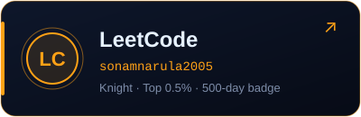
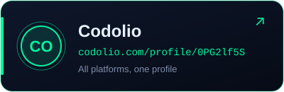
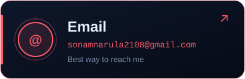
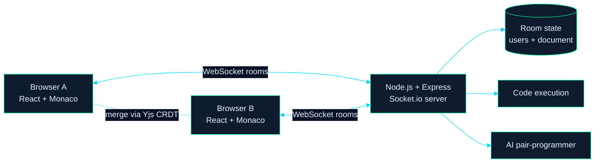
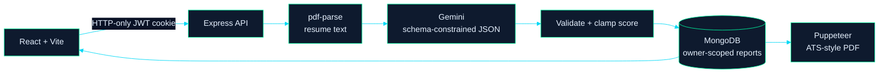
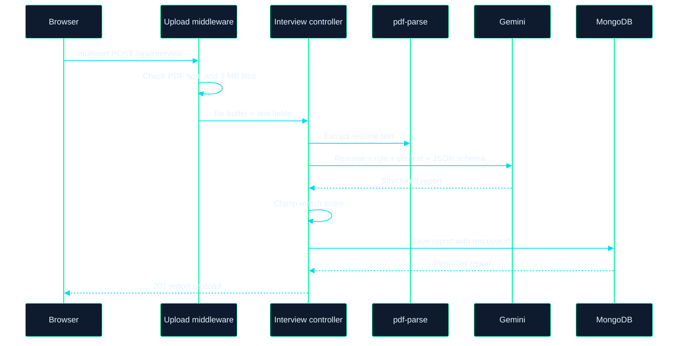
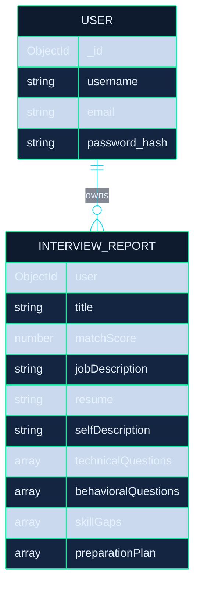

<p align="center">
  
</p>

<p align="center">
  <a href="https://github.com/SonamNarula"></a>
  <a href="https://leetcode.com/u/sonamnarula2005/"></a>
  <a href="https://codolio.com/profile/0PG2lf5S"></a>
  <a href="https://www.linkedin.com/in/sonamnarula/"></a>
  <a href="mailto:sonamnarula2108@gmail.com"></a>
</p>

<p align="center"><i>Build what I understand. Understand what I build.</i></p>

<p align="center">
  <b>
    <a href="#-about">ABOUT</a> ·
    <a href="#-by-the-numbers">NUMBERS</a> ·
    <a href="#-proof-of-work">PROOF</a> ·
    <a href="#-find-me-online">PROFILES</a> ·
    <a href="#-projects">PROJECTS</a> ·
    <a href="#-engineering-notes">NOTES</a> ·
    <a href="#️-stack">STACK</a> ·
    <a href="#-lets-talk">CONTACT</a>
  </b>
</p>

<p align="center"></p>

## 👋 About

I'm a final-year CS student at **JECRC University, Jaipur** (class of 2027). I started with C and C++, fell properly into data structures, algorithms and competitive programming, and then got curious about what sits *behind* an AI app: how information is represented, retrieved and grounded. That curiosity is what my Python and RAG work is about.

I learn by building. A tutorial tells me what something does; a project makes me understand why it works; debugging shows me where it breaks.

> **I don't want to just use technology. I want to understand enough to build with it.**

```
question → learn → build → break → debug → understand → build better
```

<p align="center">
  
</p>

### The path so far

| Stage | What I did | What it taught me |
| --- | --- | --- |
| **1. Fundamentals** | C and C++, then DSA | How memory, complexity and data structures actually behave. |
| **2. Competitive programming** | LeetCode, AtCoder, ICPC Algo Queen | Solving under a clock, with no retries. |
| **3. Building software** | React and Node apps, deployments | Real products need auth, data models, error states and docs. |
| **4. Python and AI** | RAG pipelines, embeddings, vector search | What sits behind an AI app, and where it breaks. |

### What I'm into right now

| Area | What that means in practice |
| --- | --- |
| **Algorithms and CP** | Regular contests on LeetCode and AtCoder, plus global events like ICPC Algo Queen. |
| **Full-stack products** | React and Node apps with real auth, real data models and real deployment. |
| **Applied AI** | RAG, embeddings and vector search, with LLMs treated as one layer of a system, not the whole system. |
| **Reliability** | Validating model output, failing loudly instead of faking success, and documenting honest limits. |

<p align="center"></p>

## 📊 By the numbers

<p align="center">
  
</p>

<p align="center"></p>

## 🏆 Proof of work

| Platform                 | Highlight                                                                                            |
| ------------------------ | ---------------------------------------------------------------------------------------------------- |
| **ICPC Algo Queen 2026** | Global rank **#386 of 1,063**, 5/6 solved. International, ICPC Foundation-endorsed.                  |
| **LeetCode**             | Knight tier, top 0.5% worldwide. 500-day badge.                                                      |
| **LeetCode Biweekly**    | All-Kill, every problem cleared. ~Rank 155 of 36,465.                                                |
| **AtCoder**              | Debut rank 92 / 10,763 (7/7 solved). Rank 1 among Indian participants in ABC465. 791 rating (Brown). |

If I could show only one contest it would be ICPC Algo Queen: one clock, no retries, months of prep squeezed into a single sitting.

<p align="center"></p>

## 🔗 Find me online

<p align="center">
  <a href="https://leetcode.com/u/sonamnarula2005/"></a>
  <a href="https://codolio.com/profile/0PG2lf5S"></a>
  <a href="https://www.linkedin.com/in/sonamnarula/"></a>
  <a href="mailto:sonamnarula2108@gmail.com"></a>
</p>

### 🟧 LeetCode, live

<p align="center">
  <a href="https://leetcode.com/u/sonamnarula2005/"></a>
</p>

### 🟩 Codolio, all platforms in one place

<p align="center">
  <a href="https://codolio.com/profile/0PG2lf5S"></a>
</p>

<p align="center"></p>

## 🚀 Projects

| Project | One line | Stack |
| --- | --- | --- |
| [⚡ CodeFusion](#-codefusion) | Real-time collaborative code editor on Yjs CRDTs | React, Node.js, Socket.io, Yjs, Monaco, Docker |
| [🔍 HireLens](#-hirelens) | Resume-aware AI interview prep | React 19, Express, MongoDB, Gemini, Puppeteer |
| [🌰 AcornFolio](#-acornfolio) | AI mutual-fund co-pilot with deterministic maths | Next.js, TypeScript, Prisma, LanceDB, RAG |
| [🧠 neural-folklore](#-neural-folklore) | AI learning lab | Python, LLMs, Embeddings |
| [📊 Trackify](#-trackify) | Student productivity dashboard | React, TypeScript, Vite, Chart.js |

<p align="center"></p>

### ⚡ [CodeFusion](https://github.com/SonamNarula/CodeFusion-a-collaborative-real-time-code-editor)

**Real-time collaborative code editor**: Google Docs, but for code.

Two people can type on the same line and neither loses a keystroke. Sync runs on **Yjs CRDTs**, so it works offline and merges on reconnect, with no "last write wins" overwriting.



**Features**

| Feature | What it does |
| --- | --- |
| 🔴 **Real-time sync** | Edits reach everyone in a room within milliseconds; Yjs CRDTs merge concurrent and offline edits cleanly. |
| 🏠 **Rooms** | Create or join a private room with a unique Room ID, with a one-click copy for sharing. |
| 🌐 **Multi-language** | JavaScript, Python, C++, Java, Go, TypeScript and more. |
| ▶️ **Shared code execution** | Run code and see the output inside the room. |
| 🤖 **AI pair-programmer** | An assistant that lives inside the room. |
| ⏪ **Session replay** | Review how a session unfolded. |
| 🎤 **Interview mode** | A mode built for live coding interviews. |
| ⌨️ **Typing indicators** | See who is typing, live. |
| 🌙 **Dark / light mode** | Theme preference is remembered. |
| 📱 **Responsive UI** | Works across desktop, tablet and mobile. |

<details>
<summary><b>Architecture</b></summary>

<br />

```
CodeFusion/
├── client/                 # React frontend
│   └── src/
│       ├── components/     # Editor (Monaco wrapper, language selector, output panel),
│       │                   # Room (lobby, header, participant list), UI (theme toggle, toasts)
│       ├── hooks/          # useSocket, useEditor, useRoom
│       ├── context/        # Socket and theme providers
│       └── pages/          # Home (lobby) and EditorPage (workspace)
└── server/                 # Node.js + Express backend
    └── src/
        ├── socket/         # roomHandler (create/join/leave), codeHandler (sync, typing)
        └── utils/          # roomManager: in-memory room and user state
```

- **Frontend:** React 18 with a hooks-based structure, Monaco Editor (the VS Code engine), Tailwind CSS with custom dark and light themes, React Router v6 between lobby and editor.
- **Backend:** Node.js and Express for HTTP, Socket.io for WebSocket management, room namespacing and event broadcasting, plus a lightweight in-memory room store.
- **Conflict handling:** Yjs CRDTs, so merging is a property of the data structure instead of custom reconciliation code.

</details>

<details>
<summary><b>Real-time event flow</b></summary>

<br />

| Event | Direction | Purpose |
| --- | --- | --- |
| `room:create` / `room:join` / `room:leave` | Client to server | Room lifecycle |
| `code:change` | Client to server | Broadcast an edit to the room |
| `code:sync` | Server to client | Send current code to someone who just joined |
| `typing:start` / `typing:stop` | Client to server | Typing indicators |
| `user:joined` / `user:left` | Server to client | Keep the participant list accurate |

</details>

<details>
<summary><b>Run it locally</b></summary>

<br />

```bash
git clone https://github.com/SonamNarula/CodeFusion-a-collaborative-real-time-code-editor.git
cd CodeFusion-a-collaborative-real-time-code-editor

# terminal 1: server
cd server && npm install && npm run dev

# terminal 2: client
cd client && npm install && npm run dev
```

Needs Node.js 18+. Copy `.env.example` and set the server port, the client URL (for CORS) and the client's server URL. The frontend is built for Vercel, the backend for Railway or Render, and a Docker setup is included. After deploying, update the CORS origin on the server to match the live frontend URL.

</details>

**Why it was interesting:** collaborative editing is a conflict problem, not just a networking problem. Choosing a CRDT up front meant offline edits and reconnects became a property of the data structure instead of a pile of special cases.

`React` `Node.js` `Express` `Socket.io` `Yjs` `Monaco` `Tailwind` `Docker`

[**Live demo**](https://codefusion-collaborative-editor.vercel.app/) · [**Source**](https://github.com/SonamNarula/CodeFusion-a-collaborative-real-time-code-editor)

<p align="center"></p>

### 🔍 [HireLens](https://github.com/SonamNarula/hirelens-nexus)

**Resume-aware AI interview prep**

Upload a PDF resume and a target role, and get a role-specific preparation report. The design rule: **the candidate and the role are the source of truth; the model is the reasoning layer.**



**What a report contains**

- A bounded 0 to 100 role-match score
- Skill gaps classified low / medium / high
- Technical and behavioral questions, each with the interviewer's intent and a model answer
- A day-wise preparation plan
- An exportable resume PDF rendered through a headless browser

**What ships today**

| Capability | Status |
| --- | :---: |
| Registration, login, logout, protected session | ✅ |
| PDF resume upload (PDF only, 3 MB limit) and text extraction | ✅ |
| Gemini report generation with schema-shaped JSON | ✅ |
| Match score, skill gaps, questions, preparation plan | ✅ |
| Reports saved per user in MongoDB | ✅ |
| Resume PDF export via Puppeteer | ✅ |

<details>
<summary><b>Architecture and request lifecycle</b></summary>

<br />

Backend layering: route → middleware → controller → model or service → external system. Controllers own HTTP, services own external integrations (Gemini, Puppeteer), models own persistence shape.



The browser is never trusted to provide a user id. Identity comes from the verified JWT.

</details>

<details>
<summary><b>Authentication and authorization</b></summary>

<br />

- Passwords hashed with **bcrypt** (cost 12), never stored or returned.
- JWT carries a minimal payload (user id and username) in an **HTTP-only cookie**, 24-hour lifetime, `sameSite=lax`, `secure` in production.
- `authUser` middleware verifies the cookie on every protected route.
- **Authorization lives in the query:** reports are loaded with both the report id and `req.user.id`. Another user's report returns `404`, so nothing leaks about whether it exists.

</details>

<details>
<summary><b>Data model</b></summary>

<br />



Questions, gaps and plan items are embedded in the report because they're always read as one unit. The `user` field is indexed because "list my reports" is the dominant query.

</details>

<details>
<summary><b>API surface</b></summary>

<br />

| Method | Route | Purpose |
| --- | --- | --- |
| `POST` | `/api/auth/register` | Create account, set cookie |
| `POST` | `/api/auth/login` | Log in, set cookie |
| `POST` | `/api/auth/logout` | Clear cookie |
| `GET` | `/api/auth/me` | Current user (protected) |
| `POST` | `/api/interview` | Upload resume + job description, generate report |
| `GET` | `/api/interview` | List the current user's reports |
| `GET` | `/api/interview/report/:interviewId` | Fetch one owned report |
| `POST` | `/api/interview/resume/pdf/:interviewReportId` | Generate the resume PDF |

Status codes are deliberate: `400` invalid input, `401` unauthenticated, `404` not found for this user, `409` duplicate account, `502` unusable upstream AI output, `503` provider or configuration unavailable.

</details>

<details>
<summary><b>Security model</b></summary>

<br />

**Implemented:** bcrypt hashing, HTTP-only cookie, JWT verification, protected routes, owner-scoped queries, CORS allowlist, PDF-only uploads, 3 MB limit, generic error responses to the browser, secrets kept out of source control.


</details>

<details>
<summary><b>Engineering decisions worth calling out</b></summary>

<br />

| Decision | Why |
| --- | --- |
| Structured JSON output + backend parsing | The UI needs predictable fields; invalid output is rejected, not rendered. |
| Score clamped server-side | Model output is untrusted input. |
| Explicit failure when the AI provider fails | No success-shaped fake reports. |
| Model name set by environment variable | Model availability and quotas change; deployments shouldn't need a code change. |
| Memory upload storage for the MVP | Simple and fine for small PDFs, with the object-storage path documented for scale. |
| Synchronous request for the MVP | Easy to trace end to end, with a clear queue boundary for later. |

</details>

`React 19` `Node.js` `Express` `MongoDB` `Gemini` `Puppeteer`

[**Source**](https://github.com/SonamNarula/hirelens-nexus)

<p align="center"></p>

### 🌰 [AcornFolio](https://github.com/SonamNarula/AcornFolio)

**AI mutual-fund co-pilot**

Reasons about Direct vs Regular plans, SIP/SWP/STP, XIRR, tax and exit load.

The one decision that mattered: **don't ask the LLM to do the maths.** Numbers stay deterministic in code; the AI layer handles language and retrieval only. That split is what makes the answers checkable.

```
user question
   ├─ numbers (XIRR, SIP/SWP/STP, tax, exit load) → deterministic code
   └─ explanation and context                      → retrieval + LLM
```

`Next.js` `TypeScript` `Prisma` `LanceDB` `RAG`

[**Source**](https://github.com/SonamNarula/AcornFolio)

<p align="center"></p>

### 🧠 [neural-folklore](https://github.com/SonamNarula/neural-folklore)

**AI learning lab**

The messy middle of learning AI: experiments, wrong assumptions, concepts that made no sense at first. The RAG pipeline that started here as exercises later became part of AcornFolio.

`Python` `LLMs` `Embeddings` `Vector search`

[**Source**](https://github.com/SonamNarula/neural-folklore)

<p align="center"></p>

### 📊 [Trackify](https://github.com/SonamNarula/Trackify-college-minor-project)

**Student productivity dashboard**

DSA progress, study hours and deadlines in one place. Began as a college minor project; the part I like most is that I kept using it long after submission.

`React` `TypeScript` `Vite` `Chart.js`

[**Live app**](https://trackify.wasmer.app) · [**Source**](https://github.com/SonamNarula/Trackify-college-minor-project)

<p align="center"></p>

**Also:** [NeuroNews](https://github.com/SonamNarula/Neuro-News), a category-based news reader in React, built for short breaks between DSA sessions. And [DSA](https://github.com/SonamNarula/DSA), my C++ problem-solving repo.

<p align="center"></p>

## 🔧 Engineering notes

Real problems from building HireLens, and how I separated the causes. Debugging by boundary is a habit I take seriously.

| Symptom | Actual cause | Fix |
| --- | --- | --- |
| Login returned a generic 500 | Database was connected, but `JWT_SECRET` wasn't loaded in the running process | Added the variable, restarted, added startup validation so missing config fails early |
| Account creation blocked in the browser | App opened at `127.0.0.1`, CORS allowlist only had `localhost` | Allowlisted both local origins; never a wildcard with credentials |
| AI analysis failing with "Internal server error" | Several stacked causes: missing key, stale processes, duplicate servers on one port, a retired model, a temporary provider `503` | Checked each layer independently, made the model configurable, picked one that answered a direct test request |
| `app.listen is not a function` | Typo: `module.export` instead of `module.exports` | Fixed the CommonJS export |
| PDF parsing broke on the local Node version | Newer parser version was incompatible | Pinned the compatible `pdf-parse` version and tested with a real PDF |
| Vite build failed | Latest Vite needed a Node API unavailable in Node 20.11 | Pinned the compatible Vite major |

**The lesson:** "the key exists in `.env`" is not enough. The running process must load it, the model must be available to that key, and the request must return something usable. Configuration, process lifecycle and provider availability are separate problems.

<p align="center"></p>

## 🧭 How I build

1. **Deterministic where it matters, AI where it helps.** AcornFolio keeps the maths in code; HireLens validates and clamps model output.
2. **Fail loudly.** An explicit error beats a plausible-looking wrong answer.
3. **Authorize at the query, not just the route.** A valid session isn't permission to read everything.
4. **Keep secrets server-side.** Browsers are untrusted.
5. **Document what is real.** READMEs should list what works today and mark what's planned.
6. **Debug by boundary.** Process, environment, network, auth, provider, database, UI: check each layer on its own before guessing.
7. **Design the migration path.** An MVP can be simple if its next step is clear.

<p align="center"></p>

## 🛠️ Stack

|                      |                                                                                                                                                                                                                                                                                                                                                                                                                                                                                       |
| -------------------- | ------------------------------------------------------------------------------------------------------------------------------------------------------------------------------------------------------------------------------------------------------------------------------------------------------------------------------------------------------------------------------------------------------------------------------------------------------------------------------------- |
| **Languages**        |                                                                                                                                                                                                                                                                                                                                                                                    |
| **Frontend**         |                                                                                                                                                                                                                                                                                                                                                                                |
| **Backend and data** |                                                                                                                                                                                                                                                                                                                                                           |
| **Tooling**          |                                                                                                                                                                                                                                                                                                                                                                                     |
| **AI**               |      |

**Primary:** C++  ·  **Building:** Python, TypeScript  ·  **Exploring:** GenAI

<p align="center"></p>

## 🤝 Beyond the code

| Role | Where |
| --- | --- |
| **DSA Captain**, leading 400+ members | Devcrest JU |
| **Campus Ambassador** | takeUforward |
| **National finalist** | Smart India Hackathon |
| **Round 1 cleared** | Google STEP |
| **Tech and media intern** | DD News |

<p align="center"></p>

## 💬 Let's talk

If you're building something interesting, I'd like to hear about it.

[](mailto:sonamnarula2108@gmail.com) [](https://www.linkedin.com/in/sonamnarula/) [](https://leetcode.com/u/sonamnarula2005/) [](https://codolio.com/profile/0PG2lf5S)

<p align="center"><sub>&lt;/&gt; &nbsp; built in the terminal, every number above is real &nbsp; &lt;/&gt;</sub></p>
